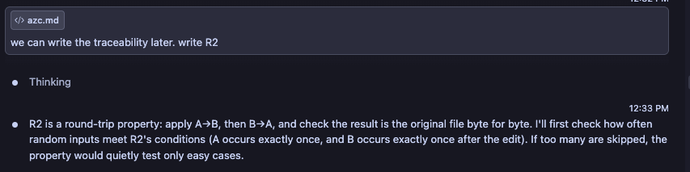
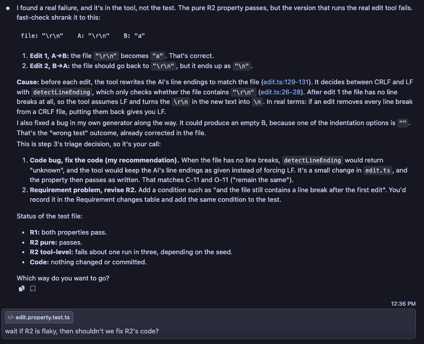
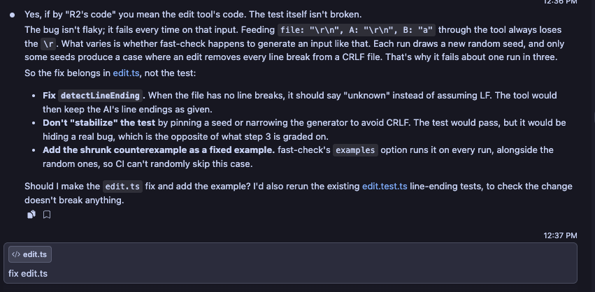
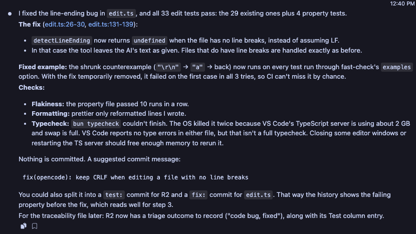

# Traceability: Alex Chen (azc)

**Target feature:** Edit tool's string replacement, in [`packages/opencode/src/tool/edit.ts`](../packages/opencode/src/tool/edit.ts)

## Requirements

| ID | Interview evidence | Requirement | Acceptance Criteria | Changed in P4? | Property (kind) | Test | Mutants it kills |
|---|---|---|---|---|---|---|---|
| R1 | C-8, C-9: "No because then I would have to erase those edits"; S-19, S-22, S-23: "Would want to revert back to unchanged version"; O-6, O-7 | If an edit can't be applied, it is rejected with an error and the file is left exactly as it was, never partially edited. | `replace("let a = 1;", "let b = 2;", "x")` throws "Could not find oldString". Running the edit tool with that request on a temporary file leaves the file's bytes unchanged. | No | For any code-like file and search text that can't match it, `replace` throws "Could not find oldString", with and without replace-all. For those edits, and for ambiguous ones where the search text appears twice, the real edit tool rejects the edit with the matching error ("Could not find oldString" or "Found multiple matches") and the file's bytes (including CRLF line endings and a BOM) are unchanged (invariant) | [`edit.property.test.ts`](../packages/opencode/test/tool/edit.property.test.ts): "R1 (invariant): replace() rejects search text that can't be found"; "R1 (invariant): a rejected edit leaves the file's bytes unchanged" | [H1](../mutants/azc/H1.patch), [H2](../mutants/azc/H2.patch) |
| R2 | C-10, S-24, O-9: "State A"; C-11, O-11: "I would want it to remain the same indentations" | Applying A→B and then B→A returns the original file byte for byte, including whitespace when A and B each match exactly once. | `f` = a 4-space-indented function containing `const rate = 0.08;`. Replace it with `0.1`, then back with `0.08`. The result `=== f`. | No | For any file where A appears exactly once and a non-empty B appears exactly once after the first edit, `replace(replace(f, A, B), B, A) === f`. The same two edits through the real edit tool, on LF or CRLF files with or without a BOM, and with the AI's text using either line ending, restore the file's bytes (round-trip). Cases where the AI's ending differs from the file's and the first edit leaves no line breaks are skipped, since nothing in the file then says which ending to restore | [`edit.property.test.ts`](../packages/opencode/test/tool/edit.property.test.ts): "R2 (round-trip): replacing A with B and then B with A restores the file"; "R2 (round-trip): two edits through the tool restore the file's bytes" | [H3](../mutants/azc/H3.patch) |
| R3 | C-13: "It should not be renamed back to a foo because you only wanted to rename the ones that are previously foos"; S-33, S-34: "Want to reject the original change ideally"; O-13 | ~~A replace-all whose new text already appears in the file is rejected, because undoing it would also change the occurrences that were there before.~~ Removed in P4. | ~~`replace("let foo = bar + 1;", "foo", "bar", true)` throws an error naming the collision. `replace("let foo = 1;", "foo", "bar", true)` still returns `let bar = 1;`~~ | Yes (removed) | N/A (removed) | N/A (removed) | N/A (removed) |
| R4 | C-11: "the spacing and indentation shouldn't change"; O-11; S-32: "If it did other things like added new lines that he didn't have, he'd be annoyed" | If the AI's search text differs from a multi-line block in the file only in leading indentation, no other block matches when indentation is ignored, and the search text doesn't itself appear exactly in the file, the edit gives the same result as the same edit with exact indentation. | An edit whose search text is a 3-line block with 2-space indentation, applied to a file where that block appears once with 4-space indentation, gives the same result as the same edit with exact 4-space indentation. A search that only drops the first line's indentation, such as `"a\n  a"` against `"      a\n  a"`, is an exact match and keeps that line's indentation. | Yes (twice: steps 1 and 3) | For any multi-line block that is the only match when indentation is ignored, changing the search text's indentation (without making it an exact match) doesn't change `replace`'s result for the same new text, including blocks that end the file and blocks with repeated lines such as closing brackets (metamorphic) | [`edit.property.test.ts`](../packages/opencode/test/tool/edit.property.test.ts): "R4 (metamorphic): re-indenting the search text gives the same result" | [H4](../mutants/azc/H4.patch) |
| R5 | S-39: "look at all the callers and the original function to make sure that they're all changed"; S-41: "convert most of these changes into some kind of regex find search and then… check all of the substrings" | When the old text appears in the file exactly, a replace-all gives the same file as replacing every non-overlapping occurrence from left to right, i.e. `content.split(old).join(new)`. | After a replace-all from `total` to `sum` in a file with three `total`s and no `sum`, the result equals `content.split("total").join("sum")`: no `total` and three `sum`s. `replace("abb", "ab", "a", true)` returns `"ab"`, which equals `"abb".split("ab").join("a")`. | Yes | For any content that contains the old text, `replace(content, old, new, true) === content.split(old).join(new)` (model/oracle) | [`edit.property.test.ts`](../packages/opencode/test/tool/edit.property.test.ts): "R5 (model/oracle): replace-all matches content.split(old).join(new)" | [H5](../mutants/azc/H5.patch) |

Properties written or suggested by opencode or another AI tool: R1, R2, R4, R5 (properties and generators written by Claude Code); R3, R4, R5 (requirement revisions suggested by Claude Code);

## Requirement changes

| ID | Original requirement (P3) | Revised requirement | Why it changed |
|---|---|---|---|
| R3 | A replace-all whose new text already appears in the file is rejected, because undoing it would also change the occurrences that were there before. | Removed. | Conflict between interviewees, and the version they agree on isn't feasible. C-13 and O-13 want undoing the rename to restore only the `bar`s that started as `foo`, which needs a history of past edits that the edit tool doesn't keep. S-34 wants the rename rejected outright. Rejecting whenever the new text already appears would also block ordinary renames, because it matches inside other words: renaming `total` to `sum` would fail in any file containing `summary`. |
| R4 | If the AI's search text differs from the file only in indentation, the edit gives the same result as an exact match, keeping the file's original indentation. | If the AI's search text differs from a multi-line block in the file only in leading indentation, no other block matches when indentation is ignored, and the search text doesn't itself appear exactly in the file, the edit gives the same result as the same edit with exact indentation. | Not feasible as written. The tool writes the new text exactly as given and never re-indents it. A single-line search with less indentation matches only the end of the line, leaving extra leading spaces: searching `"  x()"` and replacing it with `"    y()"` produces six spaces. Limiting R4 to multi-line blocks with one match keeps what C-11, O-11 and S-32 wanted: the edit shouldn't depend on the AI getting the spacing exactly right. Revised again in step 3: the property failed with the counterexample search `"a\n  a"` against the block `"      a\n  a"`. Dropping only the first line's indentation makes the search an exact match that starts partway into that line, and an exact match always wins, so that line keeps its indentation. That is the intended behavior, since AI tools often start a search after a line's indentation and write their new text the same way, so the requirement now excludes searches that appear exactly in the file. |
| R5 | After a replace-all, no occurrence of the old text remains, and the new text appears once for each old occurrence (when the new text doesn't contain the old). | When the old text appears in the file exactly, a replace-all gives the same file as replacing every non-overlapping occurrence from left to right, i.e. `content.split(old).join(new)`. | Not checkable as written, because the original claims are false. The new text can join with nearby text and form the old text again: `replace("abb", "ab", "a", true)` returns `"ab"`. The count claim only holds when the new text isn't already in the file. Checking against `split`/`join` keeps S-39 and S-41's idea of finding every match and checking it, as a check that can actually be verified. |

## Property failures and triage

R1 passed on its first run. Every other failure, with fast-check's shrunk counterexample:

| Property | Counterexample | Outcome | Action |
|---|---|---|---|
| R2, both tests | `B = ""` | Wrong test | The generator could build an empty B, because one of its indentation options is `""`. R2 requires a non-empty B, so the generator now filters out empty text. |
| R2, through the tool | File `"\r\n"`, A `"\r\n"`, B `"a"`: the round trip returned `"\n"` | Code bug | After the first edit the file had no line breaks, and the tool assumed LF, turning the restored CRLF into LF. `detectLineEnding` now returns `undefined` for a file with no line breaks, and the tool keeps the AI's line endings in that case (commit `2f93966`). The counterexample is a fixed example in the test. |
| R4 | Search `"a\n  a"` against the block `"      a\n  a"`: the edit kept the first line's indentation | Requirement problem | The tool's behavior is intended (see Requirement changes). R4 was revised and the property now skips searches that appear exactly in the file. |
| R5 | Content `"a"`, replace-all `a` → `$&`: returned `"a"` instead of `"$&"` | Code bug | Replace-all passed the new text to `String.replaceAll` as a string, which reads `$$`, `$&` and `$'` as replacement patterns. It now passes a replacer function, so the text is inserted literally (commit `e9ddb24`). The counterexample is a fixed example in the test. |

## Hand-written mutants

Each mutant is a patch in [`mutants/azc/`](../mutants/azc/) against [`edit.ts`](../packages/opencode/src/tool/edit.ts), applied from the repo root with `git apply`. The actual results are from running [`edit.property.test.ts`](../packages/opencode/test/tool/edit.property.test.ts) with the mutant applied.

| ID | Requirement | Change | Predicted killer | Actual result |
|---|---|---|---|---|
| [H1](../mutants/azc/H1.patch) | R1 | Deletes the check that the match is unique (`if (index !== lastIndex) continue`), so when the search text appears more than once the first occurrence is replaced instead of the edit being rejected. | "R1 (invariant): a rejected edit leaves the file's bytes unchanged", because `ambiguousEdit` always puts the search text in the file twice, so the tool now writes a changed file. | Killed by the predicted property. Counterexample: content `"\na\n\na\n"`, `a` → `ax`. |
| [H2](../mutants/azc/H2.patch) | R1 | Adds a "fast path" at the top of `replace`: a replace-all returns `content.replaceAll(oldString, ...)` without trying the matchers. When nothing matches, it returns the file unchanged instead of throwing. | "R1 (invariant): replace() rejects search text that can't be found", because its second check uses replace-all on text that can't be found. R5 can't catch it, since for text that appears exactly the fast path gives the same result as `split`/`join`. | Killed by the predicted property. Counterexample: content `""`, search `Z`. |
| [H3](../mutants/azc/H3.patch) | R2 | The tool keeps only the BOM of the replaced text (`next.bom`) instead of the file's own BOM (`source.bom \|\| next.bom`), so the first edit to a file with a BOM drops it. | "R2 (round-trip): two edits through the tool restore the file's bytes", in runs where the generated file has a BOM. The pure R2 property doesn't read files, so it can't see this. | Killed by the predicted property. Counterexample: file `"\n"` with a BOM, A `"\n"`, B `"a"`. |
| [H4](../mutants/azc/H4.patch) | R4 | Off-by-one in the line-trimmed matcher's end index (`k < searchLines.length - 1` becomes `k < searchLines.length`), so a match found by ignoring indentation also takes the line break after the block. | "R4 (metamorphic): re-indenting the search text gives the same result", because re-indented searches go through the line-trimmed matcher while the exact search doesn't, so the two results differ by a line break. | Killed by the predicted property, on the P3 acceptance example (2-space search against a 4-space block). |
| [H5](../mutants/azc/H5.patch) | R5 | Replace-all builds a global regex from the old text, escaping special characters with a class that leaves out `$`. A `$` in the old text becomes an end-of-line anchor. | "R5 (model/oracle): replace-all matches content.split(old).join(new)", because `replaceAllUnit` includes `$`. | Killed by the predicted property. Counterexample: content `"$a"`, replace-all `$a` → `""`. |

## Stryker comparison

### Mutation score
Seed: 42

| Run | Killed | Survived | Timeout | No coverage | Total | Score |
|---|---|---|---|---|---|---|
| Initial | 91 | 12 | 0 | 0 | 103 | 88.35% |

### Hand-written mutants Stryker never generated

| Mutant | Why |
|---|---|
| H2 | Stryker never generates this because Stryker only mutates code that already exists, and it doesn't add any code that might not be there. This check specifically asks for code to be added specifically rather than just altering pre-existing code. |
| H5 | Stryker is most likely not going to replace something with a hand-crafted regex. All it really does is make simple changes, and not more complex ones like just swapping stuff for a regex since that requires domain knowledge that an automated (non-LLM based) mutation generator wouldn't have. |

### Survivors I wouldn't have thought of

| Location | Mutation | Requirement | Would a real developer plausibly write it? |
|---|---|---|---|
| Line 26 | Removed the whole funciton body (1) | R2 | The only way that I could see a developer possibly writing this is if they wrote a function signature and then forgot to fill it in... Which now that I think about it is completely plausible, but I would've never thought to mutate it like this. |
| Line 716 | Changed `notFound = false` to `notFound = true` (11) | R1 | This one is actually extremely realistic for a developer to write, although I don't think that I would come up with it myself. This is something that a developer who's coding at 4 in the morning and not paying attention to what they're doing might end up doing. Either that, or they confuse themselves in logic and end up writing this thinking it should've been the other thing. |

### What each approach finds that the other doesn't

- **Hand-written mutants find:** Hand-written mutants find code that are more specific to the requirements themselves. For instance, in H2 and H5 (the two the Stryker never generated) required more domain knowledge to come up with, and due to that aspect, Stryker is essentially unable to come up with a mutation for those since all it does is read the code around it and make smaller local changes.
- **Stryker finds:** Stryker ends up finding bugs that could easily get overlooked by programmers themselves. For instance, small details like less than vs. less than or equal to, or adding 1 instead of subtracting 1, or other "typos" like those that are relatively common for programmers to make are generally found by Stryker. These mistakes are usually ones that nobody would think of on their own, but actually come up quite often.

### Strengthening

| Survivor | Requirement | Weakness (generator, oracle, or missing property) | Change to the property | Killed after? |
|---|---|---|---|---|
| `edit.ts:26`: `detectLineEnding` body → `{}` | R2 | Generator: `roundTripEdit` converted the file, A and B to the same line ending, so the AI's text always matched the file already and the tool's line-ending conversion was never needed | R2 tool test: the AI's text gets its own line ending (`aiEnding`), chosen independently of the file's | Yes |
| `edit.ts:27`: `text.includes("\r\n")` → `text.includes("")` | R2 | Same as above | Same as above | Yes |
| `edit.ts:28`: `if (text.includes("\n"))` → `if (false)` | R2 | Same as above | Same as above | Yes |
| `edit.ts:28`: `return "\n"` → `return ""` | R2 | Same as above | Same as above | Yes |
| `edit.ts:716`: `notFound = false` → `notFound = true` | R1 | Oracle: the tool test accepted either error message (`/Could not find oldString\|Found multiple matches/`) for both kinds of rejected edit, so reporting an ambiguous edit as not found still passed | R1 tool test: each generated edit carries its expected error, and the test checks that exact message instead of accepting either | Yes |
| `edit.ts:733`: `if (notFound)` → `if (true)` | R1 | Same as above | Same as above | Yes |
| `edit.ts:260`: `if (searchLines[searchLines.length - 1] === "")` → `if (false)` | R4 | Generator: `reindentEdit`'s search text never ends with a newline, so the code that drops the trailing empty line never runs. Generating that case exposes an implementation bug (an exact search ending in `\n` replaces that newline, but a re-indented one leaves it in place), which is left unfixed because it needs a production code change | None | No. The following survivors that weren't killed weren't killed because of a lack of specification in the requirements and an error in the code itself. Due to how vague they were, I've decided to leave these alone as I don't want to re-change the original source code (as we are beyond that now). |
| `edit.ts:260`: `searchLines.length - 1` → `searchLines.length + 1` | R4 | Same as above | None | No |
| `edit.ts:260`: `=== ""` → `=== "Stryker was here!"` | R4 | Same as above | None | No |
| `edit.ts:260`: `if` body → `{}` | R4 | Same as above | None | No |
| `edit.ts:261`: `searchLines.pop()` → removed | R4 | Same as above | None | No |
| `edit.ts:264`: `i <= originalLines.length - searchLines.length` → `i < …` | R4 | Generator: `reindentEdit` always put `"\n" + after` after the block, so the block never ended on the file's last line, the only position the mutant skips, and its random code lines almost never repeated. Not equivalent: when the line-trimmed matcher skips that position, the fallback matchers can match a shorter or different span when lines repeat, so `replace()` returns a different file | R4: the block ends the file in about a third of cases (`after` is now optional), and block lines are sometimes closing brackets (`}`, `};`, `)`), so lines repeat the way nested code does. Counterexample with the mutant: file `"\n  }\n  }\n    }\n  }"`, search `"}\n}\n}\n}"` | Yes |

### Equivalent mutants

| Location | Mutation | Why it's equivalent (2–3 sentences) |
|---|---|---|
| None | | |

### Final score

| Run | Killed | Survived | Equivalent | Score as Stryker reports it | Score excluding equivalent mutants |
|---|---|---|---|---|---|
| After strengthening | 98 | 5 | 0 | 95.15% | 95.15% (98 / 103) |

## Agent Failure Case

### Transcript that the property was generated from

The R2 tool-level property and its generator, `roundTripEdit`, were written by Claude Code during P4 (2026-11-03). In these excerpts it ran the property, found the CRLF bug and fixed `edit.ts`, but kept a generator that converts the file and the AI's text to the same line ending.






### Surviving mutant

[`agent-failure.patch`](../mutants/azc/agent-failure.patch), Stryker's block-statement mutant at `edit.ts:26`: `detectLineEnding` always returns `undefined`, so the tool never converts the AI's line endings to match the file.

```diff
-function detectLineEnding(text: string): "\n" | "\r\n" | undefined {
-  if (text.includes("\r\n")) return "\r\n"
-  if (text.includes("\n")) return "\n"
-  return undefined
-}
+function detectLineEnding(text: string): "\n" | "\r\n" | undefined {}
```

The three other `detectLineEnding` mutants at lines 27–28 (see Strengthening) survived for the same reason.

### Why the property was too weak

The property was too weak because the generator itself never reached the property. What it did was that it only applied one ending to the file, and since the text always matched the file, the conversion never did anything. Thus, when you just emptied the check for it, the property itself never actually noticed. However, once the actual generator was fixed, the comparison itself was fine, signaling that it was actually a generator failure.

### Strengthened version

The R2 tool test now picks the AI's line ending independently of the file's (commit `ae5c384`):

```ts
fc.asyncProperty(
  roundTripEdit,
  fc.boolean(),
  fc.constantFrom("\n", "\r\n"),
  async (edit, bom, aiEnding) => {
    fc.pre(edit.a !== edit.b && occursOnce(edit.file, edit.a))
    const changed = replace(edit.file, edit.a, edit.b)
    fc.pre(occursOnce(changed, edit.b))
    // If the first edit leaves no line breaks, nothing in the file says it used
    // CRLF, so text from an AI using the other ending can't be converted back.
    fc.pre(aiEnding === edit.ending || changed.includes("\n"))
    const a = edit.a.replaceAll("\r\n", "\n").replaceAll("\n", aiEnding)
    const b = edit.b.replaceAll("\r\n", "\n").replaceAll("\n", aiEnding)
    // ...write the file, run A→B and B→A through the tool, compare bytes
  },
)
```

### Evidence that it kills the mutant

- **Stryker:** all four `detectLineEnding` mutants, including this one, survived the original property and were killed after strengthening (see Strengthening, rows `edit.ts:26`–`28`).
- **Direct run with the patch applied:** both R2 tests from before the change (`17a6995`) pass. The strengthened tool test fails, with the shrunk counterexample `file "\n", A "\n", B "\n  "` (LF file) and the AI sending CRLF text: without the conversion, the round trip doesn't restore the file's bytes.
