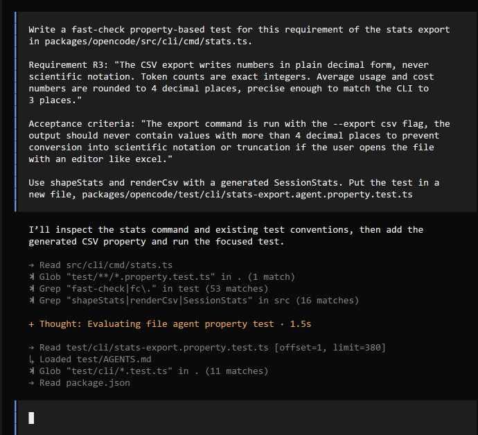
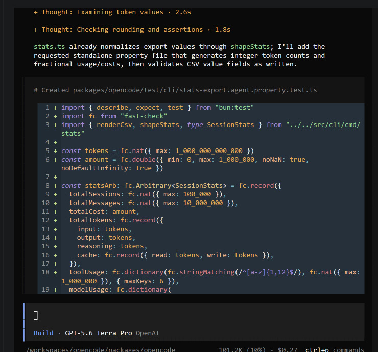
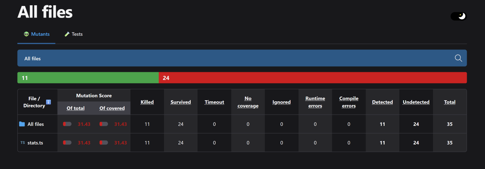
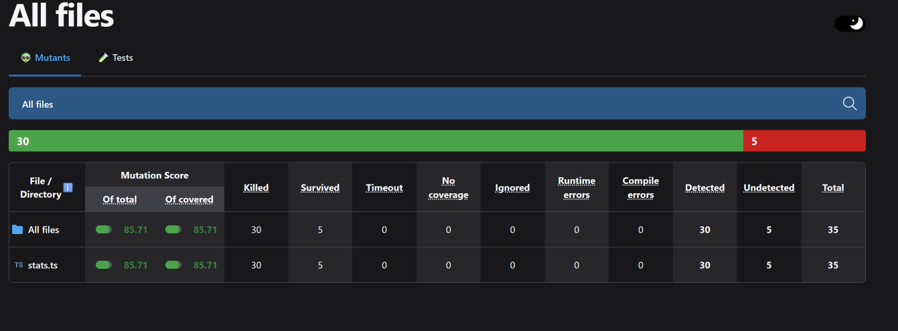

| ID | Interview evidence | Requirement | Acceptance criteria |
| --- | --- | --- | --- |
| R1 | C-12, S-11: “Probably averages, because sequencing gives you a lot of extra information that I probably don’t care about.” | Aggregate stats do not depend on the order in which messages were sent or models were used. | Two test usage histories contain the same messages (model A, then model B, versus model B, then model A). Exporting each with --export json gives identical totals, averages, and per-model rows. |
| R2 | C-17 “It should be [a] carbon copy of what’s actually in whatever opencode’s data [is].” | For the same flags, file exports contain every field the stats CLI prints, with identical values | The user runs the export stats command in all three formats, the parsed contents of each exported file should always match the cli output to the last 3 decimal places on numbers (since some stats with decimal values may get rounded to 4 decimal places) |
| R3 | S-8, C-8, O-6: “If there’s some minor differences like that in the precision, it doesn’t matter.” | The CSV export writes numbers in plain decimal form, never scientific notation. Token counts are exact integers. Average usage and cost numbers can be rounded to avoid changes from opening in Excel. Revised: average usage and cost numbers are rounded to 4 decimal places, precise enough to match the CLI to 3 places (R2). | The export command is run with the –format csv flag, the output should never contain values with more than 4 decimal places to prevent conversion into scientific notation or truncation if the user opens the file with an editor like excel. |
| R4 (to be added) | S-4, S-5, S-10: “Yeah, like I said, I worry about when you put it in the root, it would get pretty cluttered. I would say maybe if it could have its own folder and then I can close [clear?] it easy, I think that would be good.” | Exports are written to a dedicated stats subfolder, not the opencode root directory. | The user runs the export command after a session, the stats reports are written to a dedicated stats directory of the opencode app, which can be changed to a different directory on the user’s PC in settings |
| R5 (to be added) | S-9, C-9, C-11, O-7, O-9: “There should be an option and the default being replacing it is probably fine.” | By default, re-exporting in the same format overwrites the previous file. A –new flag keeps old reports and writes a new file that includes the timestamp instead. | The user runs the export command, by default the the new stats summary overwrites the old one, since the summary statistics encompass usage from the start of each time interval, if the –new flag is passed with the export stats command, a new stats report is written to the stats export directory, with the timestamp in the filename, so the latest one is easy to find. |

Requirement Changes:

All of the user requirements are feasible to implement. Requirements 1-3 are already partially implemented as the underlying logic, so they just need to be reviewed to verify they align precisely with the requirements. R3 was revised from the original: it only allowed average and cost numbers to be rounded, and now fixes them at 4 decimal places, because rounding averages to 2 places broke R2's 3-decimal match with the CLI. R5 was also changed from the original: instead of overwriting by default with a --new flag to keep old reports, every export now writes a new timestamped file by default so earlier reports are never lost, and an --overwrite flag replaces a single fixed file (opencode_stats.<format>) for users who only want the latest summary. Requirements 4 and 5 involve adding two new cli flags to specify default export path and idempotency. They could be implemented via two optional flags: --out, --overwrite

PART 5: Hand-Written Mutants

| ID | Requirement targeted | Change | Predicted killer | Actual result |
| --- | --- | --- | --- | --- |
| H1 | R1 | Comment out the sort of model rows by message count (stats.ts line 448). | R1 invariant: per-model rows are exactly the models used, ordered by message count. Without the sort, rows follow insertion order, so their order varies. | Killed |
| H2 | R2 | Add 1 to the value in the Sessions row of the markdown format string (stats.ts line 603). | R2 round-trip: parsing the json, csv and md exports recovers the same numbers. The md sessions count is always off by 1 from json and csv. | Killed |
| H3 | R3 | Remove the rounding of tokens_per_session (stats.ts line 440). | R3 invariant: csv numbers are plain decimals with at most 4 places, token counts integers. The unrounded average is written with more than 4 decimal places. | Killed |
| H4 | R4 | Reorder the resolveExportDir return so the default dir comes first: DEFAULT_EXPORT_DIR \|\| out \|\| configured. | R4 invariant: exports land in --out, else the configured dir, and never the working directory. The default is always set, so the passed out dir is never used. | Killed |
| H5 | R5 | Change args.overwrite to !args.overwrite (stats.ts line 103), flipping the --overwrite flag. | R5 idempotent: repeated exports keep every report, and --overwrite leaves one file with the latest stats. --overwrite would now keep files instead of overwriting. | Survived. The property test calls exportStats directly, so it never exercises the CLI args. |

Stryker Comparison

fast-check seed: 42

Mutation score: 55.05% (120 of 218 mutants killed, mutating stats.ts lines 418-682). Stryker generated H1 (deleting the model sort) and killed it, but it never generated H2-H5. It only swaps operators that are already in the code and never adds a "+ 1" (H2). It has no mutator that removes an ordinary function call like round() (H3). It never reorders operands (H4). H5's line 103 is outside the mutate range, and Stryker only removes negations, never adds them.

Several survivors I would never have thought of are plausible real bugs. Dropping "stats" from DEFAULT_EXPORT_DIR puts exports in the data root, which violates R4, and survives because the tests always pass a configured dir. Removing or reversing the tool sort survives because R1 only checks model order. The --tools/--models limits, the empty-history date guard, and an emptied csv case that writes markdown into the .csv file all survive too. Most other survivors are equivalent noise, like span names and blank lines. Hand-written mutants target realistic, requirement-specific mistakes and can reach code outside Stryker's range (H5 exposed the untested CLI wiring).

Killing Surviving Mutants

I strengthened the properties in stats-export.property.test.ts instead of adding example tests: 6 new properties (R2 --models/--tools limits, R2 date window, R2 well-formed markdown, R4 default dir, R4 write errors, R4 no export), 3 stronger ones (R1 also checks tool order, R3 checks the raw csv text, header and trailing newline, R4 parses the written file), and generators that now include unset and out-of-range dates and empty histories. The markdown property found a real bug: an id containing "" broke its code span, so I fixed mdCode to use a fence longer than any backtick run. H1-H4 are still killed. H5 still survives, because no property calls the CLI handler.

All 11 survivors are equivalent. Six only change Effect.fn span names (lines 497-558). Those names are used only for tracing, so the files, paths and errors are identical. Line 532 replaces "utf8" with "". Bun treats an empty encoding as UTF-8. Lines 544, 553 and 562 change default paths. Those defaults are never evaluated, because the only caller, reportStats, always passes the path from exportStats.  Line 485 replaces the value === undefined check in limitOf with false, but that check is redundant: an undefined limit still fails Number.isFinite.

Final score: 95.07% as Stryker reports it (212 of 223), and 100% with equivalent mutants excluded (212 of 212), up from 55.05%.

Agent failure case

I asked opencode (GPT-5.6 Terra Pro) to write a property for R3, quoting the requirement and acceptance criteria from the table above.

 Mutant it let survive: on stats.ts line 471, Stryker changed round()'s guard if (!Number.isFinite(value)) return 0 to if (false) return 0. Without the guard, a NaN average (which the aggregator produces for empty data) is written to the CSV as the text NaN. That breaks R3, since NaN is not a plain decimal and Excel treats it as text. opencode's property misses it because of its generator: every average comes from fc.double({ ..., noNaN: true, noDefaultInfinity: true }), so the property never feeds NaN to round(). The property also has a weak oracle. It checks that each value is formatted like a decimal, but never checks what the value is or that any rows exist. So two more mutants survive: if (true) return 0, which writes every number as 0, and an add() that does nothing, which writes a CSV with only the header row. Measured on the CSV code alone (35 mutants), opencode's property kills 11, a mutation score of 31.43%.

Strengthened version (the second test in the same file): averages come from fc.oneof(amount, fc.constantFrom(NaN, Infinity)), and the test finds each metric's row by scope, id and metric. Token and message counts must equal the source stats exactly. Costs and averages must be plain decimals within 0.00005 of the source (0 when the source is not finite). 

Evidence that strengthened test killed more mutants (strengthened has mutation score of 85.71%), running on just the 3 lines of the csv specific code:

OpenCode Written R3 test

Strengthened R3 test

